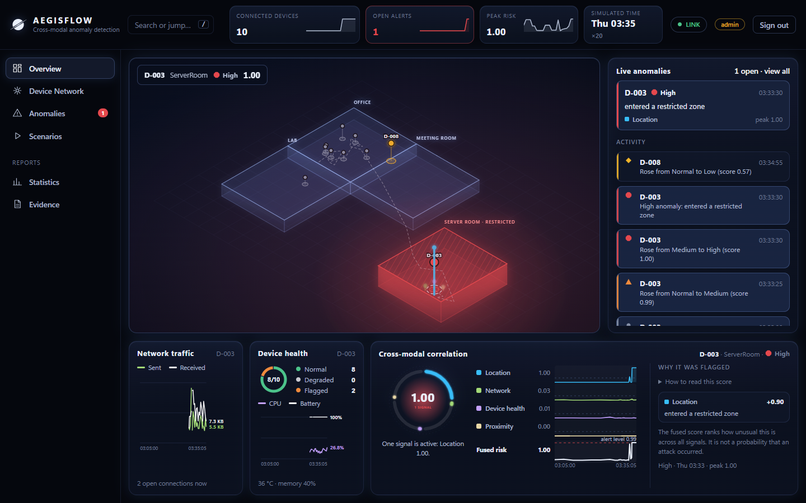

# AegisFlow



**Real-time cross-modal behavioural anomaly detection for connected devices.**

AegisFlow learns what "normal" looks like for each device, scores deviations in four signals (location, network,
device health, proximity), and asks one question no single signal can answer: *are several small deviations happening
together on the same device?* When they are, it raises an alert and explains exactly which signals contributed and why.

It runs on **simulated** devices. It is an early-warning system, not proof of an attack, and its scores are rankings,
not probabilities.

## What was found

The central claim was tested with a pre-registered final evaluation on unseen simulated data (1,331 episodes, every
system held to the same 0.1% false-alarm budget; full method and limits in the manual, §5.7):

| Question | Result |
|---|---|
| Does fusing signals beat independent detection ("any detector fires")? | **Yes, clearly:** +0.43 recall (95% interval +0.39 to +0.48) |
| Does fusion help with no training labels at all? | Yes, modestly: +0.13 (+0.10 to +0.17) |
| Does it beat the single best detector (network)? | **Not shown:** +0.02 (−0.01 to +0.04) |
| Does it beat a supervised joint model? | No: −0.09; the supervised model is better |
| Does a correlation time window help? | Not shown, even for staggered attacks |

An honest, partial result, reported with its corrections and limits. It says nothing about real fleets.

**Audit after the fact (manual §5.10, exploratory).** The results were then attacked. Counting alerts instead of rows, every
system raises 2 to 7 false alarms per device per day at that budget; fusion still beats "any detector fires" under every
stress test (unseen combinations, benign noise, noisy sensors, benign drift, lost telemetry, a missing signal), but its edge over
the single best detector appears only when the anomaly lies outside that detector's view, and it reverses under sensor noise. The
frozen thresholds do not survive noise or drift. Two public real datasets were used: TON_IoT host telemetry (device health plus
network, mixed and session-confounded) and IoT-23 real IoT traffic (network only; the frozen network threshold gives 12 to 76
false alerts per device-day on real traffic). Location and proximity have no real-data validation.

## Run it (Docker)

```powershell
cp .env.example .env          # then put two different long random tokens in it (there are no defaults)
docker compose up -d --build
```

Open **http://localhost:8080** and sign in with the **admin** token to run the demo, or the **viewer** token to watch.
In the Demo panel start the fleet (about a minute to learn each device's normal behaviour), select a device, and inject
a scenario. The spec's seven-step walkthrough is in [docs/DEMO.md](docs/DEMO.md); `python scripts/demo_flow.py` runs it
from the command line.

The stack is three containers (Redis, API, nginx + dashboard). Only the dashboard is exposed, on `127.0.0.1`. Put TLS in
front before serving anyone else.

## Documentation

| | |
|---|---|
| [docs/AegisFlow-Technical-Manual.md](docs/AegisFlow-Technical-Manual.md) | The reasoning behind every decision, the experiments, every bug found and what it taught, and the limits. Start with its headline findings and §7.1 |
| [docs/DEMO.md](docs/DEMO.md) | The seven-step demonstration, step by step |
| `docs/results/` | The raw results of the validation and final experiments |

## Layout

| Path | Purpose |
|---|---|
| `contracts/` | Shared data shapes: telemetry, zones and geometry, scenarios, ground-truth episodes |
| `simulator/` | Device simulator with labelled anomalies |
| `backend/` | Streaming pipeline, detectors, correlation, alerts, API |
| `ml/` | Dataset builder, comparison controls, the pre-registered experiments |
| `frontend/` | React + TypeScript dashboard |
| `docker/`, `docker-compose.yml` | Packaging |
| `scripts/` | End-to-end browser check, stack smoke test, narrated demo |
| `models/frozen_design.json` | The learned fusion and alert thresholds the server loads (fitted on validation seeds only) |
| `tests/` | 170 Python tests (some need Redis) |

## Develop

```powershell
python -m venv .venv
.\.venv\Scripts\python -m pip install -e ".[dev]"
docker compose -f docker-compose.dev.yml up -d        # Redis only, no tokens needed
.\.venv\Scripts\python -m pytest                      # ~6 min; add -m "not slow" to skip the live-demo tests
```

API without Docker (port 8010, because 8000 is often taken):

```powershell
$env:AEGIS_ADMIN_TOKEN  = "choose-a-long-admin-token"     # at least 16 characters, different from the viewer token
$env:AEGIS_VIEWER_TOKEN = "choose-a-long-viewer-token"
.\.venv\Scripts\python -m uvicorn --factory backend.api.app:create_app --port 8010
cd frontend; npm install; npm run dev                     # http://localhost:5173, proxies /api to the API
npm test                                                  # 47 unit and component tests
```

Checks that drive the real system (with the stack running; they need `pip install playwright`, which uses the installed Edge):

```powershell
python scripts/e2e_dashboard.py     # whole UI flow in a real browser; fails on any failed request or console error
python scripts/smoke_stack.py       # Docker packaging guarantees: headers, body limit, non-root, no tokens in logs...
python scripts/demo_flow.py         # the narrated seven-step demo through the API
```

## Reproduce the research

```powershell
.\.venv\Scripts\python -m ml.dataset --seeds 10 19 --workers 4     # validation data, ~10 min
.\.venv\Scripts\python -m ml.validate --out data/results/e2.json   # experiments E1/E2, ~15 min
.\.venv\Scripts\python -m ml.export_design                         # the artefact the server loads
```

The final test run (`python -m ml.final_eval`) refuses to run twice on the same seeds: they were spent by design.

## Limits

Simulated data only; the scenarios and effect sizes are my own model. The real-data check the spec asked for was not
done. No TLS, key rotation, per-user accounts or audit log. Single node. All verified on Windows with Docker Desktop.
The full list is in the manual, §7.1.
