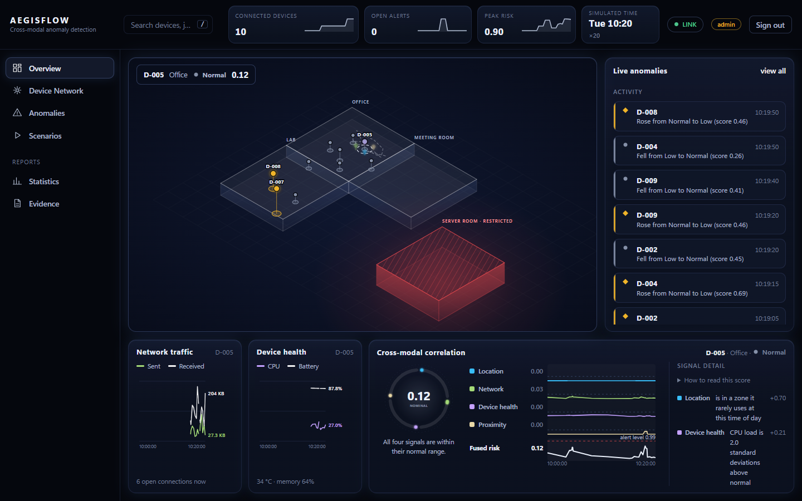
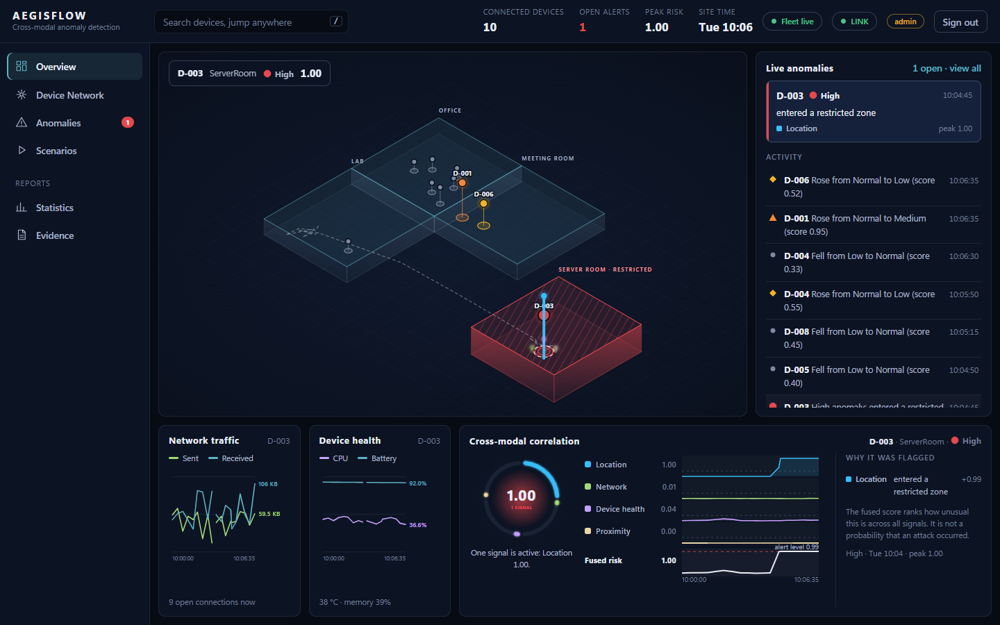
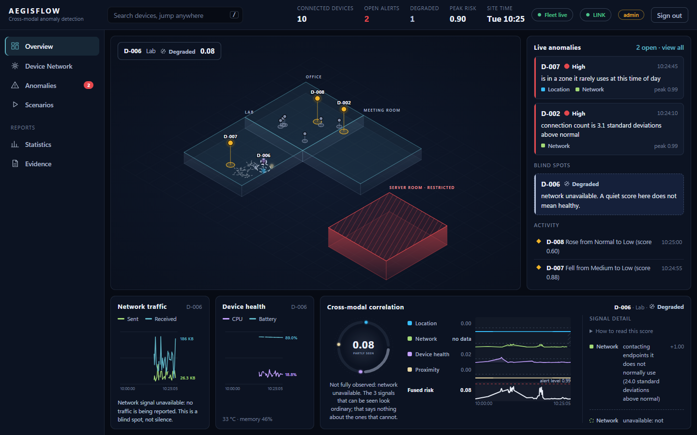
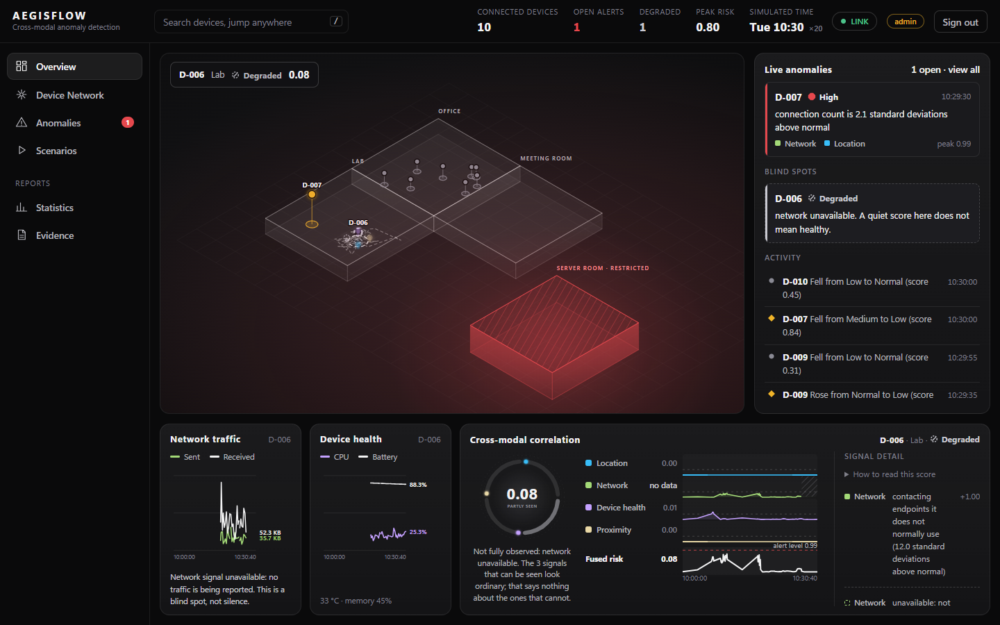
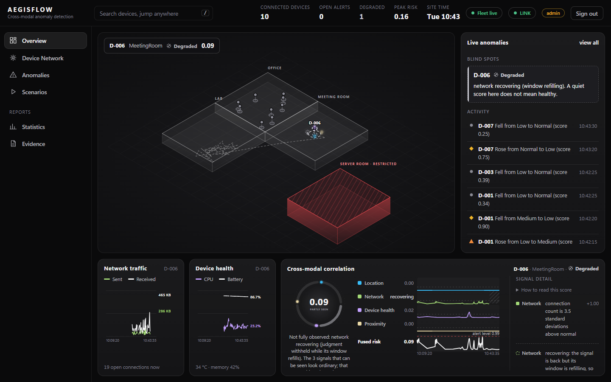
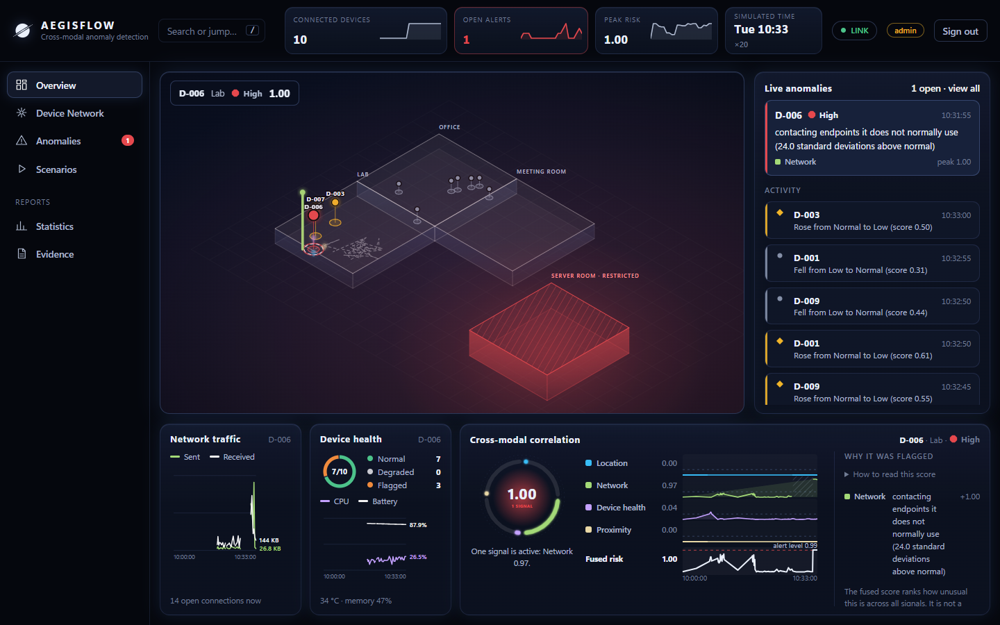
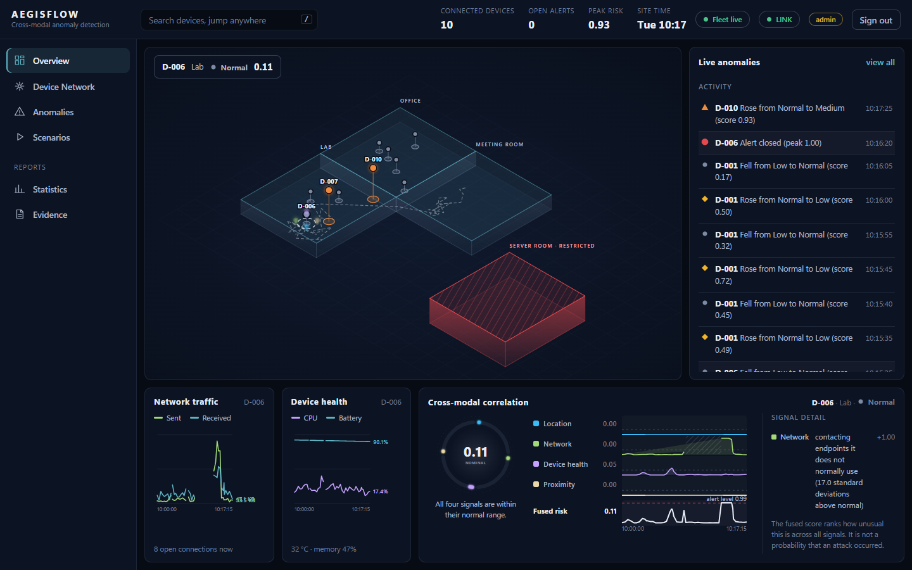

# The AegisFlow demonstration: one honest story

About four minutes. The fleet is **simulated** (ten devices in a 130 m facility); what is real is the pipeline: telemetry through Redis, per-signal
detectors, fusion, alerts, and a dashboard that says what it can and cannot see. The whole story is also scripted and checked by a browser run:
`python scripts/demo_story.py` regenerates the screenshots below and fails if any scene stops showing what is claimed.

**Start:** `docker compose up -d --build`, open http://localhost:8080, sign in with the admin token from `.env`, open **Scenarios**, press
**Start fleet** (the dashboard shows a calibration while each device learns its own normal, about a minute).

The idea in one line: **four weak signals agreeing is stronger evidence than any one of them, and a signal that is missing is not evidence of
anything.**

## Scene 1: a normal device

Select any quiet device on the map. Four signals are seen, the score is low, the badge says **Normal**.
*Knows:* what each of its four signals looks like compared with this device's own history at this time of day.
*Cannot know:* whether "ordinary for this device" is also "safe" (a device that is already compromised teaches the baseline that compromise is normal).

## Scene 2: a device becomes anomalous

**Scenarios → Breach**: a device walks into the restricted server room. The location signal fires, the alert opens with its reason in plain
language, and the correlation lanes show which signals moved and what the fused score did. Try **Whisper** (several weak deviations together) to
see the case the project is about: no single lane is alarming, the fused risk is.
*Knows:* which signals contributed and by how much. *Cannot know:* intent. An authorised visit looks identical (97–98% of benign look-alikes are flagged).

## Scene 3: a signal outage

**Scenarios → Lose network signal** for another device. It is not an anomaly and no alert opens, but the device is **never shown as Normal**: the badge
says **Degraded**, the top bar counts it, the live feed lists it under **Blind spots**, the network lane reads *no data*, and the score is
computed from the three signals that remain, judged by a threshold validated for exactly those three.
*Knows:* that it is partly blind, and which signal is missing. *Cannot know:* what the network is doing.

## Scene 4: an attack inside the blind spot

While the network signal is gone, **Exfiltrate** the same device. Nothing alerts. The dashboard still says **Degraded: a quiet score here does not
mean healthy.** This is the honest limit: an attack in the missing signal's territory is invisible, and the system says so instead of pretending.

## Scene 5: recovery is not instant

When the outage ends the signal is back, but its one-minute smoothing window is nearly empty and judging a nearly empty window produces false alerts
(measured: 3 to 20 per device-day). So the detector withholds judgment until the window has refilled, and the device says **recovering**.

## Scene 6: the alert, late

The exfiltration is now observed and the alert opens. It is late by the length of the blind period plus the refill: **the blind time is not recoverable**.
The feed records *signal restored: fully observed again* and the alert names its reason.

## Scene 7: everything restored

**Restore normal** ends the episodes; no blind spots and no open alerts remain.

## What to say if asked

- *"Does it beat a good single detector?"* Not in general (+0.02, interval includes zero); it clearly beats "any detector fires" (+0.43), and it covers
  anomalies the single detector cannot see. See [RESEARCH.md](RESEARCH.md).
- *"Is this real data?"* The fleet is simulated. Public real traces were replayed through the unchanged system (network signal only): the states behave as designed but the shipped threshold raises far too many false alerts on real benign traffic (31.6 per device-day). Offline candidate detectors held the budget in one public testbed.
- *"Does it detect real attacks?"* Not measured. Four attempts to build a fair evaluation stopped at pre-registered feasibility gates (no dated onsets with a clean, continuous baseline). That is a limit of the evidence, not a result in either direction.
- *"What changed because of testing?"* Two real defects found on a validation seed before scoring: false alerts after outages and a GPS-loss clock bug.
- *"What would you do next?"* A dataset or fleet with dated attack onsets and verifiably continuous recordings, to measure detection; an alert budget low enough to run in production; handling for drift and cold start.

## If something looks wrong

| Symptom | Likely cause |
|---|---|
| "Start fleet" is missing | A demo is already running (Scenarios shows **Stop**). |
| Nothing alerts | The baselines are not ready, or the device is not the one selected in Scenarios. |
| "Degraded" never appears | The signal-loss episode needs the fleet to be live; check the target device. |
| The page cannot be reached (error -102) | Docker Desktop is not running, or the stack is stopped: `docker compose up -d`. |
| `docker compose build` times out pulling base images | No route to the registry. `docker compose -f docker-compose.yml -f docker-compose.overlay.yml up -d --build` layers the current code onto the previous images (see `docker/api.overlay.Dockerfile`). |
